# 验证记录

最近验证日期为 2026-11-13。新 Mac 基线、1.7.1 和 1.7.2 使用 Xcode 27.2（27B52）及 iOS 27.2 SDK。1.7.0 及更早版本的历史记录使用 Xcode 27.1（27A9275）及 iOS 27.1 SDK。最低系统版本为 iOS 27.0。

## 1.7.2 连续签到天数（2026-11-13）

- 在版本号更新前，iPhone 18 Pro / iOS 27.2 通过全部 347 项单元测试和 2 项账户入口界面回归。新增用例覆盖总天数为 0 或跨周、日历为空、两项查询部分失败、换号、跨日，以及签到成功后从服务器重新读取天数。结果位于 `build/signin-streak-20261113/`。真实账号一次登录、服务器返回的连续天数及真机侧载待安装后验证。
- 1.7.2 / build 14 的 arm64 真机 IPA 通过 ZIP、版本、架构、最低系统、未签名状态、Metal 和字典等检查。SHA-256 为 `45e10c53ba73fa3afbffe38d51f85d6f53864a32481580941db1d133ce432957`。

## 1.7.1 统一日常登录（2026-11-07）

- “我的”首页仅保留顶部“登录菠萝包”按钮，钱包区不再重复显示登录；登录表单、会员页、书库重登录和未登录 VIP 阅读统一引导 App 账号。旧网页授权移入“兼容设置”，既有会话继续独立保存。会员页有 App 会话时跳过旧网页身份读取，保留仅网页会话的历史会员只读兼容。
- 安卓 APK 的登录、正文 API 注解及已有 Cookie 同步 WebView 实现已重新核对，证据与未验证的互通边界见 [账号接口记录](API_COMPATIBILITY.md)。没有实际提交账号登录、购买、签到或领奖。
- 18 Pro / iOS 27.2：337 项全量单元测试、8 项相关 UI 测试通过，0 失败、0 跳过。Duo / iOS 27.2：同样 337 项单元与 8 项 UI 通过，0 失败、0 跳过。
- 新增单元覆盖未登录 VIP 阅读进入统一登录错误而非网页专用提示；新增 UI 验证首页仅一个登录按钮、空表单禁止提交、兼容设置二级导航与返回、会员入口使用同一登录表单。其余 7 项 UI 回归覆盖头像换号、会员礼包、原有账户导航、钱包及单章确认、两种阅读时长回执、未登录福利入口。新增后的 UI 总数为 15，本轮运行其中受影响的 8 项，未把此前基线的全部 14 项视为本轮全量重跑。
- 已检查测试截图中的 18 Pro 账户首页和兼容页；新登录入口在原生列表中显示，文字无截断。Duo 使用本次实际活动屏幕验证，未将另一屏幕截图当作当前窗口。
- 最终证据位于 `build/login-unification-20261107/`：`final-unit-18pro.xcresult`（337 项）、`final-ui-18pro.xcresult`（8 项）、`final-duo.xcresult`（337 + 8 项），附日志和结果 JSON。`screenshots-18pro/`、`screenshots-duo/` 保留新增用例截图。移除钱包重复按钮前的中间版本 UI 执行已主动中断，不作为最终通过证据。
- 功能回归在版本号更新前完成，随后仅更新发行版本为 1.7.1 / build 13，并使用全新 `build/release-1.7.1` 目录构建 arm64 未签名真机 IPA；未重复运行相同功能测试。本轮不等同于真实账号登录、服务器网页免登录互通或真机测试，真实账号的一次登录由用户安装新版后验证。
- 发行包独立检查通过：版本 1.7.1 / build 13、arm64、最低 iOS 27.0；ZIP 完整，Metal 库存在，正文字典校验和正确。无签名、描述文件、测试插件、APK 或 Debug 夹具；打包时移除调试符号，发行二进制中无本机 `/Users/` 路径。IPA 大小 8,354,161 字节，SHA-256 为 `cbf930b324decd5988c0f1faf4262d5366ed893c6d580943727acc520b4b5adc`；本地审计记录位于 `dist/release-1.7.1-audit.json`。

## 2026-11-07 新 Mac 复工基线

源码基线为 `500a03a165a3831882b0bc07f108f2fd39a75089`，v1.7.0 / build 12。已打开现有 Xcode 工程；本轮开始时许可及 `xcodebuild -checkFirstLaunchStatus` 检查已通过，无需再次接受许可。实际执行 Metal 编译器时发现组件缺失，安装 Apple Metal Toolchain 27B47 后可正常编译。主机为 arm64 / macOS 27.2（26B8125）。

使用全新 `build/resume-27.2-20261107` 构建目录，以及独立的 `FlowReader Baseline 18 Pro` 和 `FlowReader Baseline Duo` 模拟器。保留模拟器临时签名 `CODE_SIGNING_ALLOWED=YES CODE_SIGN_IDENTITY=-`，覆盖真实系统钥匙串的虚构会话测试。没有改动应用源码、测试断言、版本或签名 Team。

| 模拟器 | 全量单元测试 | 现有全部 UI 用例 |
| --- | --- | --- |
| iPhone 18 Pro / iOS 27.2（24B8117） | 336 通过，0 失败，0 跳过 | 14 通过，0 失败，0 跳过 |
| iPhone Duo / iOS 27.2（24B91016s） | 336 通过，0 失败，0 跳过 | 首轮 13 通过、0 失败、1 跳过；横屏姿态调整后，跳过的 1 项单独补跑通过，0 跳过 |

Duo 首轮 `testImmersiveCurlAndLandscapeSpread` 在横屏前提检查处跳过：`XCUIDevice.orientation` 未改变实际活动窗口的竖屏姿态。尝试通过 Device Hub 调整时，macOS 拒绝了窗口辅助功能控制访问；用户手动切至横屏后，同一源码、同一断言的完整用例通过，验证短拖取消、斜向翻页、前后台位置保持、双页文字锚点与单/双页切换。Duo 的最终 14 项覆盖来自首轮与独立补测两份报告，不表述为首轮零跳过，也不等同于所有折叠姿态都已验证。

两机 UI 覆盖作者多层导航、头像换号隔离、书签/进度条、冷启动恢复、长目录定位/倒序/自然章节顺序、下载/阅读/字号/切章/续读、推荐网格、账户入口，以及会员礼包、单章确认和阅读时长的 Debug 离线场景。测试未使用真实读者账号，不代表真实扣款、领奖、阅读时长入账、云进度写回或真机音频/后台验证。

本地证据保存在 `build/baseline-20261107/`（被 Git 忽略），每项均包含 `.log`、`.xcresult` 和 `-summary.json`：

- `unit-18pro`、`unit-duo`：两机全量单元结果。
- `ui-18pro`、`ui-duo`：两机全量 UI 首轮结果。
- `ui-duo-landscape`：Duo 横屏补测结果。

复现时使用上述两个独立模拟器的实际 UDID，以及新的结果包路径；先构建运行单元测试，再以 `test-without-building` 运行 UI。当前 UDID：18 Pro 为 `FBD1E86D-3534-4BA4-882D-CB56E6625DC7`；Duo 为 `6C07B96F-D0EC-4BA2-BED7-1D1018C72E09`。完整命令保存在各 `.log` 开头。

构建仅出现未依赖 AppIntents 时的元数据提取提示；Duo 工具日志另出现系统 build 字符串的 `invalidDigitCount(91016)` 解析提示，测试报告仍正常生成且未记录测试失败或运行期警告。未生成或覆盖发行 IPA，未提交 Git 或发布远端更新。

## 1.7.0 原生作者主页

- 对照 Android 5.2.84 的作者接口、详情作者点击和作品跳转，明确区分作者 `authorId` 与社交账号 `accountId`。公开资料与完整小说作品按匿名 GET 读取；三位真实作者、共 15 本公开作品的结构与编号验证通过。未使用读者账号或执行关注、私信等写操作。
- iPhone 18 Pro / iOS 27.0：336 项全量单元测试通过；iPhone Duo / iOS 27.1：新增作者协议与页面状态 16 项测试通过。覆盖旧书籍索引缺少作者编号、身份不匹配、字段缺失、空作品、资料/作品独立失败、取消可重试、刷新保留旧数据、晚到请求不覆盖新结果。
- 两机作者界面流程通过：书籍署名进入、头像加载、简介/作品数、作品跳转、再次进入作者并打开另一作品、逐层返回、横竖屏和浏览至最后一本；既有三列推荐纵向浏览两机回归通过。测试使用原创作者与作品及本地依赖，不冒充真实作者界面。Release 不包含这些 Debug 双参数夹具。
- 首轮发现值类型导航目标未在嵌套作者页面正确解析，改为每张卡片直接构造原生导航目标；连续多层浏览与返回已验证。18 Pro 横屏测试原应用级滑动产生无窗口的错误坐标，改为对实际 ScrollView 滑动后通过，未用等待或放宽断言掩盖。
- Release 1.7.0 / build 12：arm64、最低 iOS 27.0；ZIP、版本、架构、Metal 库、正文字典校验和及未签名状态检查通过。不含签名、描述文件、测试插件、APK 或探测文件。原有 Duo 模拟器安装更新并保留数据。
- 本次提供公开作者资料与小说作品；官方个人页的动态、私信、关注和其他社交栏目未迁移。真实空作品作者未找到，空列表行为仅在离线测试验证。

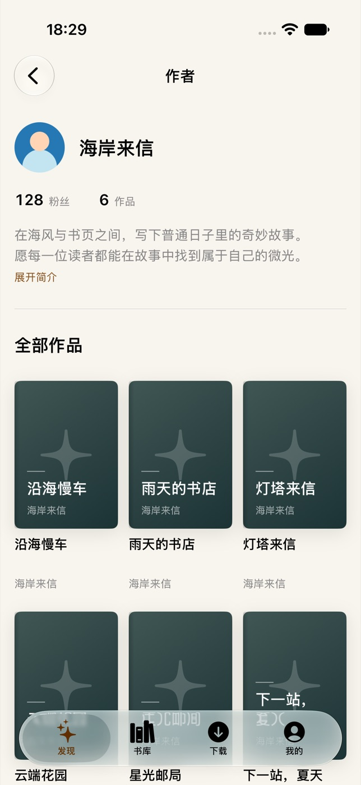

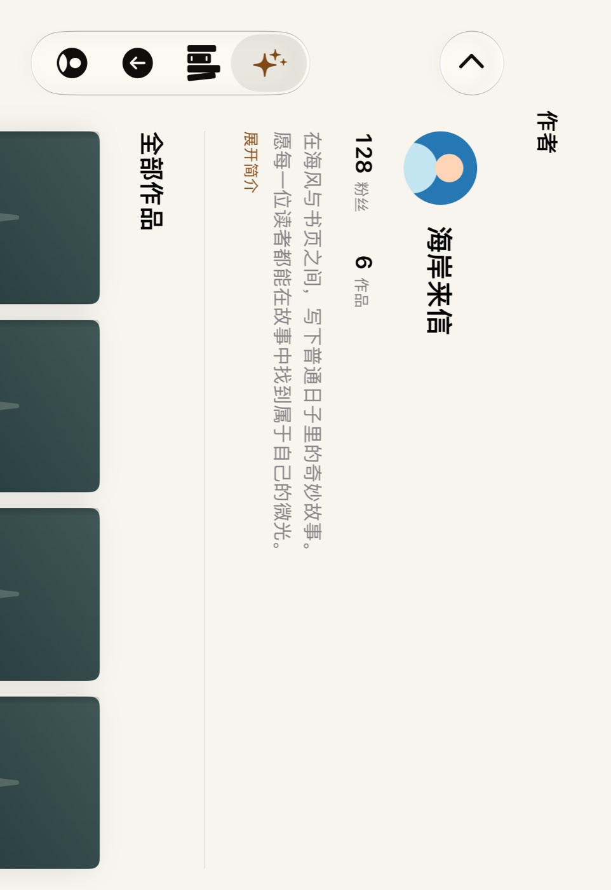

## 1.6.0 真实阅读时长

- 对照 APK 的 `CommonApi.updateReadingTime`、`lw.aa.E0` 与 `lw.qf`：确认小说类型为 2、五字段 JSON、增量秒数及北京时间日期；没有采用参考实现的固定书号或固定时长。
- iPhone 18 Pro / iOS 27.0：320 项全量单元测试通过。iPhone Duo / iOS 27.1：计时、协议、异步报告与日常福利相关 41 项通过。33 项新增计时测试覆盖实际经过时间、跨章余数、跨日、后台、两分钟空闲、换号与过期请求、未知回执不重放。
- 两机各 2 项计时 UI 流程通过。初始合成任务为 3599 / 3600 秒；真实打开原创样书并停留至少 3 秒，再离开阅读，离线服务确认后才显示 60 / 60 分钟与手动领奖按钮。模拟未确认回执时保留 59 / 60 分钟、禁用领奖并明确提示；刷新不会重放。
- 阅读控件、书签与进度条、前后台及冷启动恢复两机各通过；18 Pro 另通过仿真翻页与横屏双页流程，共 9 条机型 UI 流程。最终补充排除自动朗读后，全量单元测试和两机计时 UI 流程再次通过。原有 Duo 模拟器只安装更新，保留数据。
- 离线场景只在 DEBUG 且同时提供 `--uitesting` / `--reading-time-fixture` 时启用；身份、任务读取和时长接收全部依赖本地注入。不会载入真实会话或提交真实时长，也未点击模拟/真实领奖按钮。官方实际入账及任务规则仍以服务端返回为准，本轮未做真实账号入账验证。
- Release 1.6.0 / build 11：arm64、最低 iOS 27.0；ZIP、版本、架构、Metal 库、正文字典校验和、隐私 API 用途及未签名状态检查通过，不含证书、描述文件、测试插件或 APK。

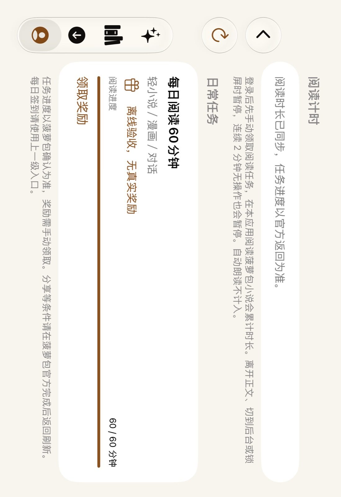

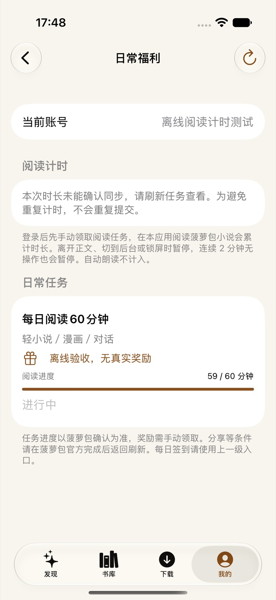

## 1.5.3 会员礼包领取资格

- 对照提供的 APK 礼包模型与按钮分支：`residueDay` 是有符号剩余天数，`<= 0` 可领取，1 显示“明日再来”，其他正数显示冷却天数。旧版拒绝负数，导致已到期礼包显示“资格待确认”；现保留有效负整数并按安卓版判定。
- `interval` 为周期元数据，不再额外阻止服务器已确认到期的礼包。账号身份、真实会员资格、已知礼包类型、领取前再次查询、并发互斥及会话隔离均保留。缺失或无法解析的冷却值仍不启用领取；缺少周期元数据时不猜测本地成功回执的释放时间。
- iPhone 18 Pro / iOS 27.0：287 项单元测试通过；iPhone Duo / iOS 27.1：会员礼包、日常福利与回执保护相关 25 项单元测试通过。覆盖负数、零、正冷却，缺失/非法字段、无会员、未知礼包和刷新后资格变化。
- 两机各 2 项 UI 流程通过：每日 20 代券可领取、每周礼包仍在冷却；仅在内存模拟领取后每日变为“明日再来”，刷新及返回重进仍禁止重复领取；未登录时福利入口要求登录且无可执行领取动作。
- 首轮 UI 断言误以为原生 `LabeledContent` 的账号昵称是独立文本，系统实际合并为“当前账号, 昵称”；据导出的可访问性树修正匹配方式，并让数量断言匹配文字而非同标识图标，保留资格、数量和禁重检查后两机通过。
- 所有领取测试使用双启动参数限定的 Debug 离线场景，经过生产解析及领取请求校验，但不发送网络请求。本轮原有 Duo 模拟器仍提示账号需重新登录，未重新验证真实账号的礼包回执，也没有提交真实领取、扣款或购买操作。
- Release 1.5.3 / build 10：arm64、最低 iOS 27.0。ZIP、版本、架构、Metal 库、正文字典校验和及未签名状态检查通过；不含描述文件、签名目录、测试插件或 APK。已更新原有 Duo 模拟器，保留账号与书库。

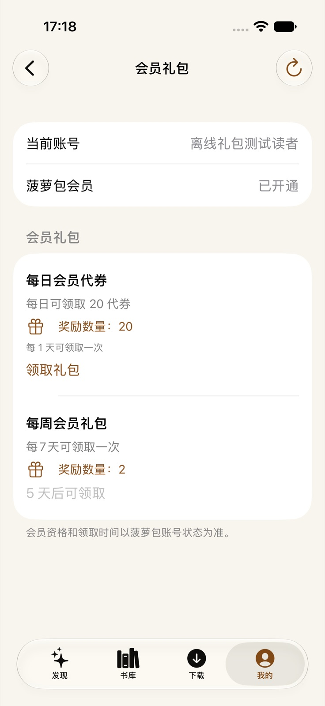

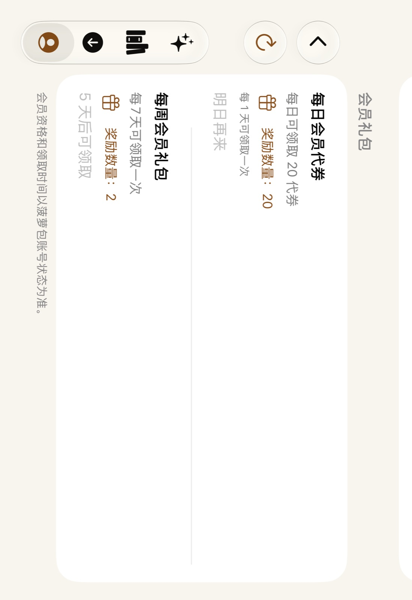

## 1.5.2 账号头像

- 根因是“我的”页头固定绘制人物符号，没有使用账号资料中的头像地址。已接入圆形真实头像，并复用有限容量的缩略图缓存与图片降采样，缺少头像或加载失败时显示默认图标。
- 对照官方 APK 的 `Account.getAvatar()` 与个人页面图片加载调用，确认正式字段为 `avatar`。账号资料、钱包与会员资料统一保留该字段，兼容协议相对地址、HTML 实体和转义斜线；不猜测替代字段或补造图片路径。
- 头像显示绑定账号身份和会话代次。切换账号后立即清除旧头像，晚到的图片请求不能覆盖新账号。
- iPhone 18 Pro / iOS 27.0：284 项单元测试通过；iPhone Duo / iOS 27.1：头像解析、钱包、会员和图片缓存相关 27 项单元测试通过。
- 两机各 2 项 UI 流程全部通过：头像加载成功→切换无头像账号→重新加载→切换加载失败账号→反复切换，以及既有原生标签与账号入口回归。截图使用原创几何头像；测试身份和控件仅在 Debug 的两个明确启动参数同时存在时启用，不包含于 Release。
- 原有 Duo 模拟器在本轮检查时提示账号需重新登录，未将离线头像测试表述为真实账号再验证。本轮未访问购买、扣款或领奖操作。
- Release 1.5.2 / build 9：arm64、最低 iOS 27.0。ZIP、版本、架构、Metal 库、正文字典校验和及未签名状态检查通过；不含描述文件、签名目录、测试插件或 APK。已更新原有 Duo 模拟器，保留账号及书库数据。

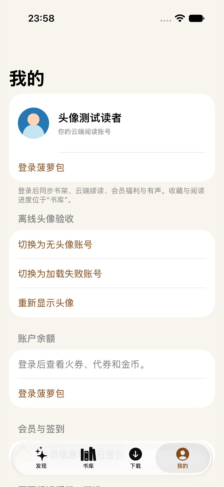

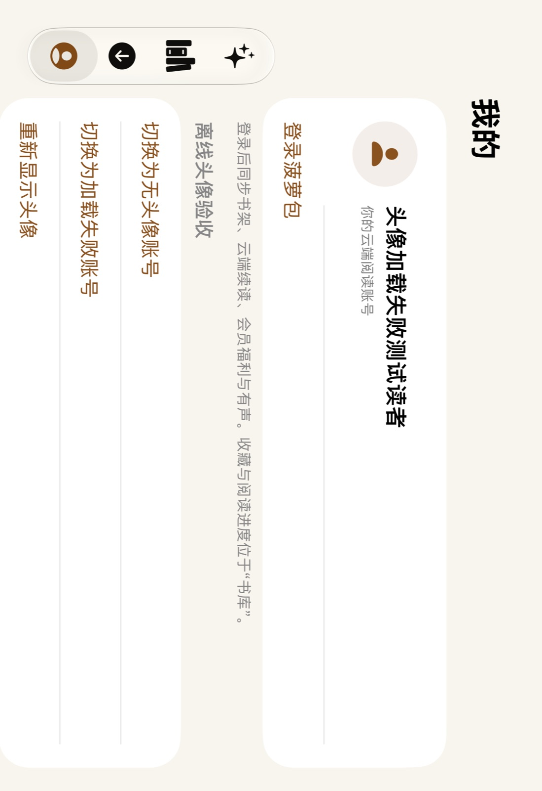

## 1.5.1 阅读目录定位与倒序

- 打开阅读目录时自动居中当前章节并高亮“正在阅读”；提供原生正序／倒序切换、记忆排列偏好和定位当前章节按钮。显式切到倒序显示末章，关闭再打开仍回到正在阅读的章节。
- 分卷使用卷 ID 与连续出现顺序，同名卷不会混合。倒序同时反转卷序及卷内章节，保留正文前后章的自然顺序。
- 1,200 章原创离线夹具从第 876 章续读，包含重复卷名、非单调章节 ID 和第 876/877 章跨卷边界。两机 UI 实际验证首次定位、首末章切换、跨卷定位、关闭重开、选择第 877 章后前后章访问及退出阅读后继续阅读；夹具仅以两个明确启动参数在 Debug 启用，Release 不包含测试正文。
- 首轮长目录用例在底部“下一章”点击处失败，界面证据显示事件穿过箭头空白落到正文并隐藏工具栏。扩大上下章按钮为 44×44 pt 完整可点击区域后，保留原断言的测试通过。
- 冷启动直接恢复阅读器后，目录独立读取既有订阅状态接口，不再依赖先打开作品详情页。复用缓存及增量回执，刷新失败保留已有标记，账号切换与旧请求结果隔离；本地、免费及混合作品目录不发请求。新增 8 项模拟客户端测试，不将其等同于真实账号再验证。
- iPhone 18 Pro / iOS 27.0：278 项单元测试通过；iPhone Duo / iOS 27.1：14 项目录与订阅状态相关单元测试通过。
- 两机各 2 项 UI 流程全部通过：新增长目录完整操作，以及既有下载→阅读→字号→切章→书库续读回归。Duo 覆盖其实际横屏目录布局。
- Release 1.5.1 / build 8，arm64、最低 iOS 27.0；ZIP、版本、架构、Metal 库、正文字典校验和及未签名状态检查通过，不含描述文件、签名目录、测试插件或 APK。本轮未使用真实账号、正文或扣款接口。

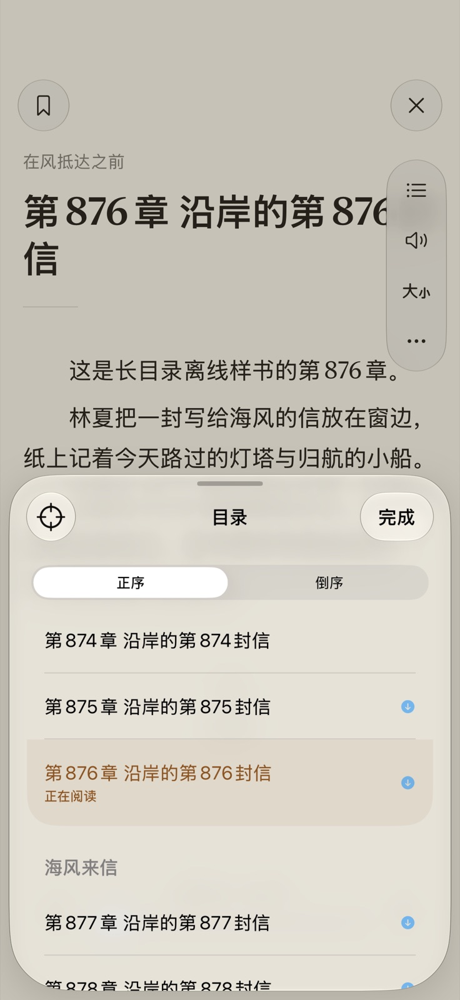

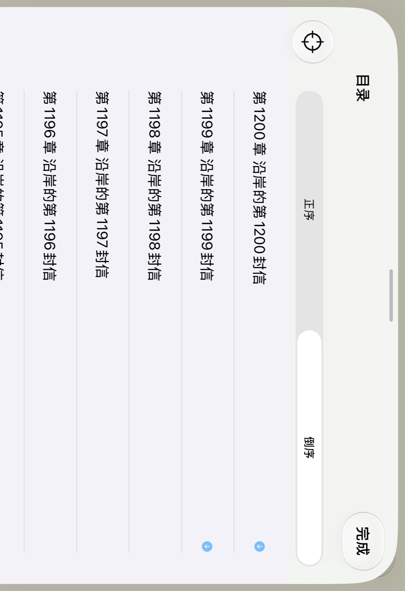

## 1.5.0 云端进度、订阅记录与三列推荐

- 官方 APK 的日期工具对无时区阅读时间追加 `+0800`。已补固定北京时间解析、最近阅读排序，以及成功回执和晚到云端响应的顺序保护。
- 真实 VIP 账号只读核对：收藏书架与最近章节顺序有效；首批六本书从完整目录得到有效章节百分比；一个已订阅长篇的消费记录完整分页至空页，已付费记录与目录章节匹配，已购与当前可阅读状态无冲突。未提交真实购买、领奖或进度写入；探测代码和响应未进入源码或安装包。
- 订阅查询每页最大 20 条已实测确认。目录先显示当前权限，再逐页补齐已购状态；确认过的记录按账号缓存，退出后不会丢弃已确认页。
- 进度目录只加载可见卡片，最多两个并发；完整目录校验、取消后重试、缓存失效、账号隔离及服务端身份变化的晚到回执均有回归覆盖。百分比按章节位置计算，当前末章未读完不假定 100%。
- 264 项单元测试在 iPhone 18 Pro / iOS 27.0 通过；云端状态、目录解析、订阅记录相关 45 项测试在 iPhone Duo / iOS 27.1 通过。
- iPhone 18 Pro 与 iPhone Duo 各 8 项界面流程全部通过：三列推荐纵向滚动、原生页签与账号入口、阅读与排版、沉浸翻页及横屏双页、书签与进度条、前后台/冷启动恢复、离线余额与购买确认、未登录福利入口。Duo 覆盖实际横屏布局与原生侧边标签栏。
- Release 1.5.0 / build 7：arm64、最低 iOS 27.0。ZIP、版本、架构、Metal 库、正文字典校验和及未签名状态检查通过；不含描述文件、签名目录、测试插件、APK 或真实账号探测文件。已更新用户原有 Duo 模拟器，保留账号和书库。

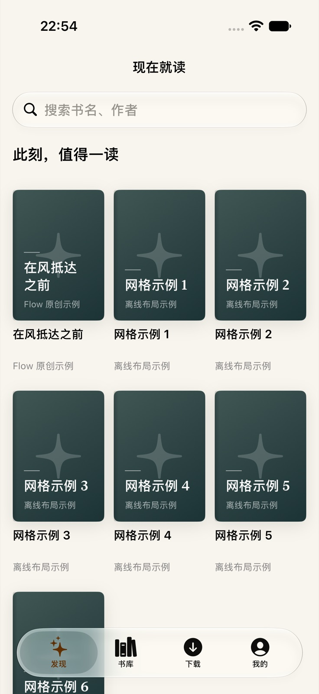

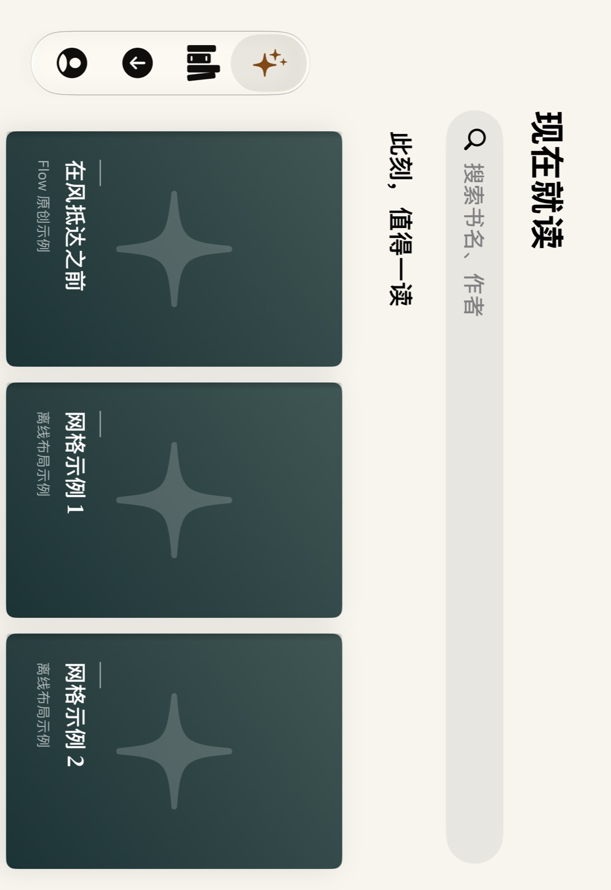

## 1.4.0 正文还原、余额与单章订阅

| 环境 | 验证范围 | 结果 |
| --- | --- | --- |
| iPhone 18 Pro / iOS 27.0 | 全部单元测试、7 项 UI 流程 | 235/235、7/7 通过 |
| iPhone Duo / iOS 27.1 | 全部单元测试、外屏实际横屏的 7 项 UI 流程 | 235/235、7/7 通过 |

- UI 记录包含必要的定点重跑：原生确认浮层省略取消按钮，测试改为点击浮层外部并避开灵动岛；账户页滚动导致原生标签栏最小化，测试先向下滚动恢复。取消后不解锁、明确确认后进入阅读的断言均保留，两机完整购买流程最终通过。
- 新增 42 项单元覆盖字符还原、旧缓存修复、余额解析、购买契约与状态。真实接口与离线购买夹具严格分离，夹具仅在 Debug 且两个测试启动参数同时存在时启用。
- 修复 App 文字接口遗漏字符置换还原的问题：`isContentEncrypted=false` 仍可能包含传输置换文字，不能直接当作可读正文。使用注明来源的 3760 项映射，只做一次 Unicode 字符还原；缺少资源时明确报错。
- 旧版格式 3 的 App 正文缓存读取时校验作品/章节身份，原子保存为格式 4；本地导入、网页 OCR 格式 2 和已还原的格式 4 不再转换。阅读、继续下载和导出使用同一修复入口，失败保留旧文件并提示。
- 使用用户重新连接的账号完成真实只读检查：一个免费章节和两个已授权 VIP 章节经生产 Swift 还原流程后，抽查开头均为连贯中文。未把真实正文或完整接口响应加入源码、测试夹具或发行资源。
- 真实火券、代券与金币均成功读取；已授权章节报价为零且不能购买，需要订阅的章节读到正价。一部作品的当前目录返回 785 章可阅读、292 章需订阅、0 章未知；这是验证时的状态，不是购买记录数量。
- 安卓目录主要提供当前价格，不提供每章购买记录。因此零价显示“可阅读”、正价显示“需订阅”；只有明确购买字段才显示“已购买”，避免把会员/限免可读误称为历史购买。
- 单章订阅使用 APK 和上游交叉核对的 `POST /novels/{bookID}/orderedchaps`。原生确认框显示章节、账号、合计价格和可用余额；关闭自动订阅与全书购买。价格或账号变化须重新确认，超时等未确认结果持久阻止重复提交。
- 真实账号测试没有提交订阅、扣款或领取奖励。购买提交及取消、重复点击、换账号、报价变化和异常回执通过离线测试验证；不将这些测试等同于真实扣款成功。
- 阅读器保留左上角当前位置书签按钮，书签列表移至“更多 → 书签”，移除右侧重复的书签图标。
- Release 1.4.0 / build 6、arm64、最低 iOS 27.0；ZIP、版本、架构及正文字典 SHA-256 检查通过，包含 Metal 库，不含签名目录、描述文件、测试插件、APK 或真实账号探测文件。已将新版安装到用户原有 Duo 模拟器，保留账号及书库数据。

## 1.3.0 跟手卷页、书库密度与阅读恢复

| 环境 | 验证范围 | 结果 |
| --- | --- | --- |
| iPhone 18 Pro / iOS 27.0 | 全部单元测试、6 项 UI 流程 | 193/193、6/6 通过 |
| iPhone Duo / iOS 27.1 | 全部单元测试、外屏实际横屏的 6 项 UI 流程 | 193/193、6/6 通过 |
| 两款模拟器 | 补充短拖取消、斜向拖动、卷页返回前台及横屏双页回归 | 均通过，双页用例未跳过 |

- 阅读工具中的重复书名/章节标题已移除，正文自身标题保留；工具开关不改变正文宽度。
- 普通手机可用宽度 320–420 pt、常规字号下书库使用三列，宽屏自动增加列数；无障碍大字号减少列数。封面按目标显示尺寸直接缩略解码，缓存硬预算 24 MiB / 96 项，并发最多 3 项；此预算不含当前可见视图持有的图片。
- 仿真翻页用公开 Metal API 的 64×64 纸面网格，二维手势控制弯曲方向，支持取消、反向、双栏正背页。纸张覆盖全窗口，正文继续避开摄像头。减少动态效果保留系统平移。每帧不重新排正文，纹理缓存硬预算 64 MiB / 6 页（不含当前帧持有纹理及 drawable）。
- 渲染仅在交互/收尾时运行；失活、后台、离开阅读器时停止，后台边界确保最后提交的命令已调度。符合 Apple 的 [Metal 后台处理要求](https://developer.apple.com/documentation/metal/preparing-your-metal-app-to-run-in-the-background)。
- 根据 Apple 的 [ProMotion 指引](https://developer.apple.com/documentation/quartzcore/optimizing-iphone-and-ipad-apps-to-support-promotion-displays) 请求当前屏幕支持的刷新率；**这不构成真机稳定 120 FPS 的实测保证**。
- Home 后立即返回保留阅读工具与位置；显式终止进程后自动恢复原章节、段落/段内位置；主动关闭阅读后再次启动只恢复所选页签，不重新弹出阅读器。原有全书库同步编码写盘已改为当前书的小进度文件，同位置不重复写；旧版进度兼容保留。
- 最早一次冷启动 UI 用例误用 `Other` 查询滚动视图，修正为跨控件类型查询后完整通过；不是掩盖正文未恢复。
- 本轮没有连接用户报告问题的自行签名真机，无法确认其进程为何结束，也未归因于签名工具。“我的 → 关于菠萝阅 → 运行诊断”可查看启动标识、前后台时间及实际安装包退出配置，不含账号、书名、正文或凭据，不会自动上传。
- Release 1.3.0 / build 5、arm64、最低 iOS 27.0，ZIP/架构/版本检查通过，包含 Metal 库，不含描述文件、签名目录、测试插件或 APK。发行包没有 `UIApplicationExitsOnSuspend`，后台模式仍只用于音频。

GPU 预览可从仓库根目录运行 `swift scripts/preview-curl.swift /tmp/flow-curl-preview` 复现。Apple M3 Max、800×700 离屏、120 帧、8192 三角形和两次绘制：本次 GPU 均值 0.073 ms、P95 0.186 ms、最大 0.806 ms；仅说明该离屏着色工作量，不包括 iPhone 输入、快照准备、UI 合成，也不是整机帧率或 Books 对比测试。

下图为生产着色器绘制的原创文字中途帧；其后为 Duo 模拟器实际阅读工具截图。

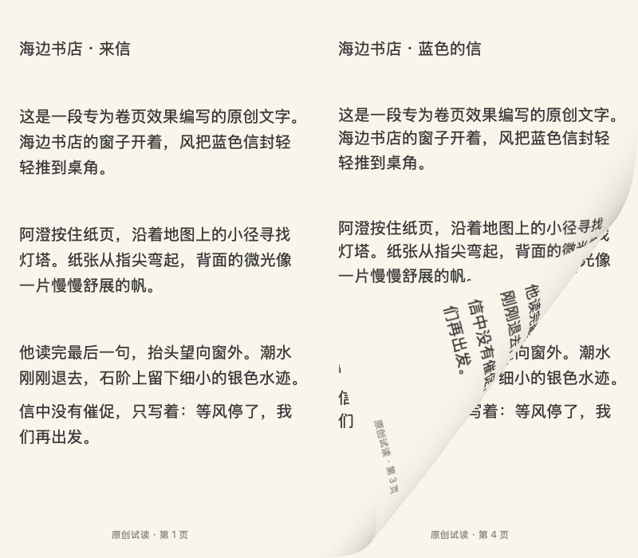

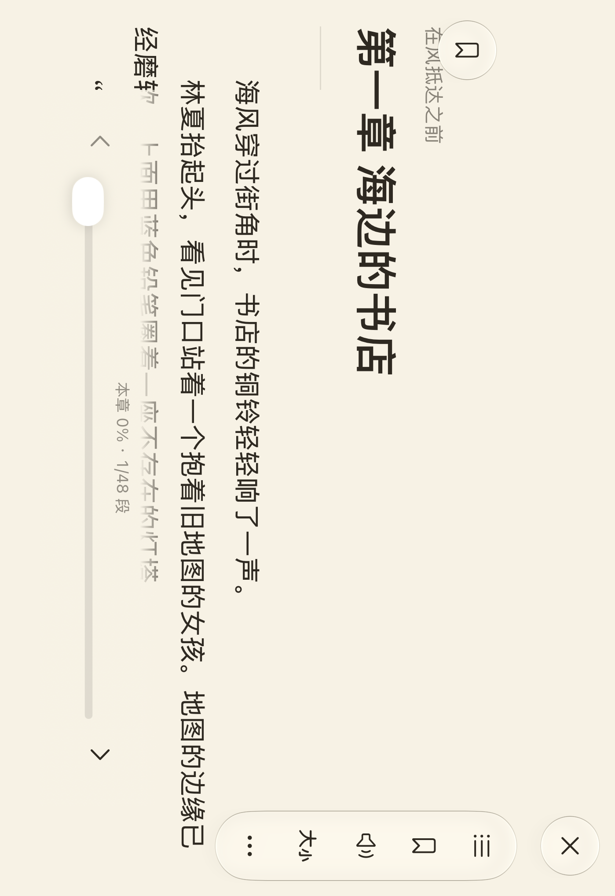

## 1.2.0 账号服务、福利与阅读验证

| 环境 | 验证范围 | 结果 |
| --- | --- | --- |
| iPhone 18 Pro / iOS 27.0 | 全部单元测试 | 158/158 通过 |
| iPhone Duo / iOS 27.1 | 全部单元测试 | 158/158 通过 |
| iPhone 18 Pro / iOS 27.0 | 5 项 UI 流程 | 5/5 通过 |
| iPhone Duo / iOS 27.1 | 外屏实际横屏下的 5 项 UI 流程 | 5/5 通过 |

- iPhone 18 Pro 的 Books 式书签用例已按实际交互修正测试预期：恢复阅读后默认进入沉浸模式，轻点正文显示控件后再操作。该用例单独完整重跑通过。
- Duo 横屏账户页的签到提示位于可滚动列表下方，测试补充滚动后重新验证通过。最终进度遮罩调整后，两款机型均重跑书签、跳转与进度拖动流程通过；Duo 仿真翻页与双栏流程未跳过。
- 1.2.0 / build 4 为 arm64 未签名 Release 包；ZIP、版本和架构检查通过，不含描述文件、签名目录、测试插件或 APK。
- 人工检查展开内屏的默认沉浸与控件显示：正文保留紧凑页边距，右侧工具浮在正文上方，不再预留整条空栏。
- 新增单元覆盖 App 主账号与可选网页登录的独立状态、本地过期与刷新取消后的账号归属、App-only 云进度调用、旧账号响应隔离、App 书架解析、授权明文正文、日常任务状态及会员礼包领取请求契约。

使用已连接账号完成以下真实只读验证，未把账号标识、正文、订单或完整接口响应加入源码或应用资源。数量仅表示验证时的服务返回值。

| 项目 | 真实只读结果 |
| --- | --- |
| App 主账号书架 | 读取 270 本文字小说，缺失作者 0 本，失败分类 0 个；不依赖有效的网页登录 |
| App 云端阅读记录 | 读取 265 条章节级记录 |
| App 授权 VIP 正文（历史验证不足，已纠正） | 当时仅确认 `autoOrder=false` 请求和 5731 字、120 段的结构，未验证单字置换后的语义；版本 3 实为未还原传输正文，不能据此宣称明文正确 |
| 会员礼包 | 读取 4 个礼包及当前会员资格；每日礼包剩余 1 天，其余 3 个礼包剩余 5 天，与服务器返回状态一致 |
| 日常福利 | 已读取真实任务状态；确认 `status=0` 且 `recordId>0` 表示已接受但未完成，不能再显示为待接受或可领取 |

本轮没有真实接受福利任务、领取任务奖励或会员礼包，没有验证新的 App 云进度 `PUT /user/NovelViews/{novelId}` 写入，也没有上报阅读福利时长或分享、广告等任务完成事件。领取和新进度写入的验证目前限于合成测试数据、请求构造及账号边界；只读成功不等于领取或写入成功。

已授权 VIP 图片识别属于历史网页兼容路径，供无 App 登录时备用；1.2.0 的 App 主账号阅读使用上述文字接口，但漏掉单字置换还原；该缺陷及版本 3 缓存在 1.4.0 修复。

当前阅读界面截图使用原创样书；按钮隐藏后正文仍保持相同宽度。

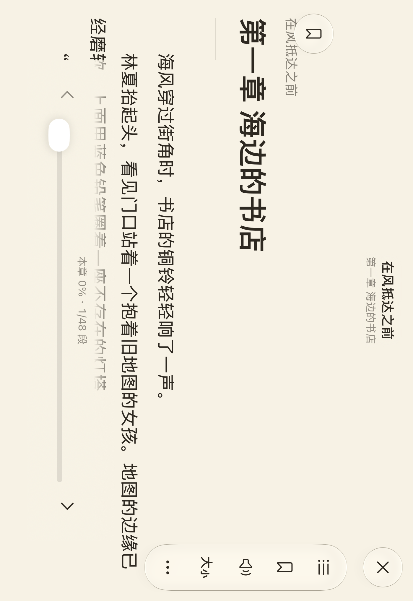

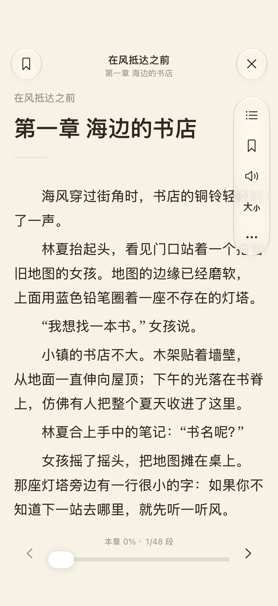

## 1.1.0 沉浸阅读验证

- iPhone 18 Pro / iOS 27.0：101 项单元测试与 3 项 UI 流程通过；随后补充的 3 项原生翻页容器测试也全部通过，共 104 项单元测试。
- iPhone Duo / iOS 27.1：104 项单元测试通过。外屏的标签/账户及下载/滚动阅读流程通过，新增沉浸式翻页流程在 Device Hub 实际横屏姿态下完整通过；展开内屏的 3 项 UI 流程也全部通过。
- 新增验证覆盖：Core Text 分页无丢字或重复、组合字符边界、字号与旋转重排的文字定位、旧进度兼容、覆盖上下安全区的整页动画容器、局部摄像头遮挡与紧凑页边距。
- 原生控制器测试确认双页使用 `.pageCurl`、中间书脊和两个不同正文页面；减少动态效果下改为 `.scroll`，双页仍按两页为一组连续前进，单页显示独立正文。
- UI 验证默认隐藏工具、轻点显示、真实左右翻页、横屏双页/单页切换和关闭后续读。Duo 外屏竖屏正文宽度超过窗口的 80%，避免给角落摄像头预留整条侧栏；内外屏切换另作人工检查。
- Duo 模拟器的 Device Hub 姿态可能不响应 `XCUIDevice.orientation`：诊断时发出横屏指令后，窗口仍为 466 × 678。测试会明确跳过未满足横屏前提的用例；本次通过记录来自实际切到横屏后的完整运行，未将跳过计为通过。点击定位到当前阅读元素，截图枚举所有屏幕，避免操作或截取未启用的另一块屏幕。
- 浅色图标背景已改为纯白，使用原生 Icon Composer 格式与渲染器验证；前景图层保持原样，Dark / Mono / TintedDark 渲染与修改前一致。
- 1.1.0 / build 3 为 arm64 未签名 Release 包；ZIP 完整性、版本与架构检查通过，不含描述文件、签名目录、测试插件或 APK。新增阅读验证使用原创样书和隔离偏好，未操作真实账号、购买章节或提交签到。

## 1.0.1 增补验证

- iPhone 18 Pro / iOS 27.0：全部 86 项单元测试与 2 项完整 UI 流程通过。
- iPhone Duo / iOS 27.1：全部 86 项单元测试通过。共享测试设备上的阅读流程曾被页面切换打断，改用不含个人账号的独立 Duo 模拟器后，2 项完整 UI 流程全部通过。
- 新增覆盖：书架分类/分页失败、作者补全、账号隔离；购买与可读状态、旧缓存迁移、多帧 VIP 图片识别；云端章节解析、续读与写入边界；签到空数组、确认回执优先、跨账号/跨日缓存隔离。
- iPhone 18 Pro UI 流程验证新增“会员与签到”页面、账号服务连接表单及取消返回，未执行真实签到。
- 模拟器关闭签名时没有系统钥匙串所需的应用身份权限，会导致官方网页登录成功后保存失败。改用 `CODE_SIGNING_ALLOWED=YES CODE_SIGN_IDENTITY=-`，Xcode 为模拟器注入应用身份，真实系统钥匙串测试通过。测试只使用随机命名的虚构会话，不操作用户的登录条目。
- 1.0.1 真机 IPA 为 arm64 未签名包，版本号 1.0.1 / build 2。完整性检查通过，不含签名、描述文件、测试插件或 APK。
- 真实账号书架作者补全全部成功；认证目录与匿名目录的同章报价对照验证了账号可读权限。官方 App 云记录读取成功；当时通过网页兼容 `addviewrecord` 提交并保持原章节不变后，服务器记录时间推进，确认该网页写回可由 App 读取。这不构成 1.2.0 新增 App `PUT` 写入的实测证据。
- 签到查询的成功空数组已实际验证，不再误报为损坏数据。测试未重新提交当天签到，也未购买任何章节。

以下原有机型 UI 记录来自 1.0.0；本次新增功能的验证范围以上述增补为准。

## 真实服务

原生 Swift 客户端在未登录状态调用 SFACG 服务，得到以下结果。数量为验证当时的返回值，后续会随作品更新而变化。

| 项目 | 结果 |
| --- | --- |
| 搜索“魔女” | 返回 16 部小说 |
| 发现页推荐 | 返回 18 部小说 |
| 小说 292551 详情 | 书名、作者及 120 字简介读取成功 |
| 小说 292551 目录 | 返回 1906 章，其中 188 章为免费章节 |
| 免费章节 3644868《第一章 病人》 | 正文读取成功，共 3426 字、97 段 |
| 同作品有声目录 | 返回 2007 条音轨；未登录不会获得授权播放地址 |

真实小说正文和接口响应没有加入发行源码或应用资源。内置《在风抵达之前》是独立原创演示内容。

## 自动化测试

| 环境 | 已完成的验证 | 状态 |
| --- | --- | --- |
| iPhone 18 Pro / iOS 27.0 模拟器 | API、安全边界、本地书库与刷新状态共 16 项单元测试 | 16/16 通过 |
| iPhone Duo / iOS 27.1 模拟器 | 同上 16 项单元测试 | 16/16 通过 |
| iPhone 18 Pro UI | 原生标签、下拉刷新、账户入口及下载→阅读→字号→切章→书库续读 | 2/2 通过 |
| iPhone Duo 内屏 UI | 同上流程，使用内屏原生侧边标签 | 2/2 通过 |
| iPhone Duo 外屏 UI | 同上流程 | 2/2 通过 |

已有单元测试覆盖请求签名固定向量、非法输入、Web/App Cookie 隔离、HTTPS、域名与路径范围、过期会话、HTML/登录信息解析、HTTP/API 错误传播，以及导入、保存、恢复、导出和下载暂停/恢复/取消。刷新回归测试覆盖 Swift 与 URLSession 取消、真实刷新失败、分页失败重试、旧搜索响应隔离及取消后再次刷新。

另已手动检查 Duo 外屏横屏两个方向，以及关闭→半折叠→展开切换时发现页与原生侧栏的显示。原生栏靠近右下摄像头的视觉间距限制见 [设计说明](DESIGN.md)。

发现页刷新遭取消时保留现有书籍，不把 `cancelled` 作为服务失败展示。真实网络失败仍会显示可重试的提示，已显示内容保留。

## 安装包

Release 包为 arm64 未签名构建，最低系统 iOS 27.0；ZIP 完整性检查通过，不含描述文件或签名目录。SHA-256 校验值随 Release 附件提供。

## 发布内容检查

已检查当前 Git 发布候选文件及文档截图，未发现真实账号、用户密码、会话 Cookie、个人令牌、签名证书、描述文件或本机用户目录。源码中的 App Basic 字段和签名盐是参考项目公开的协议常量；测试 Cookie 使用固定的 `test-session` 假数据。

Web/App 会话分别保存在系统钥匙串，密码不持久化。官方登录页使用非持久化 WebKit 数据存储。源码不包含真实账号测试状态，构建输出和签名文件由 `.gitignore` 排除。

## 尚未验证的边界

- 官方网页登录、账号服务身份、VIP 等级、真实书架和云端章节记录已验证；新的真实签到奖励、日常福利奖励及会员礼包领取尚未验证。新的 App 云进度 `PUT` 写入尚未真实提交，阅读福利时长未上报。
- 1.2.0 的 App 正文只读验证仅覆盖权限和响应结构，未能证明语义正确；字符还原的验证以 1.4.0 记录为准。历史网页备用图片路径曾返回 3277 字、72 段，并核对正文开头与结尾；多帧长图另用原创合成图片测试。图片识别仍可能存在个别错字，应用不会自动购买章节。
- 真实授权有声音轨播放、下载、锁屏控制及后台连续播放尚未用授权账号和真机完整验证。
- 自行重新签名、侧载安装和签名到期行为未在真实设备验证。发行 IPA 为待用户自行签名的 arm64 应用包。
- 模拟器测试不替代真机折叠切换、扬声器、蓝牙音频、系统中断或后台内存回收验证。

## 截图

截图中的书籍为原创演示数据，不代表真实账号书架。

| iPhone 18 Pro 发现页 | iPhone 18 Pro 阅读页 |
| --- | --- |
| 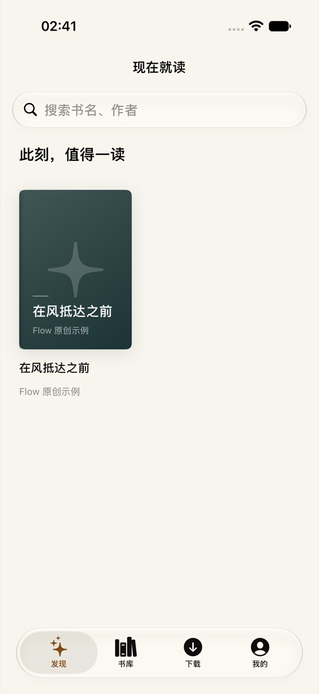 | 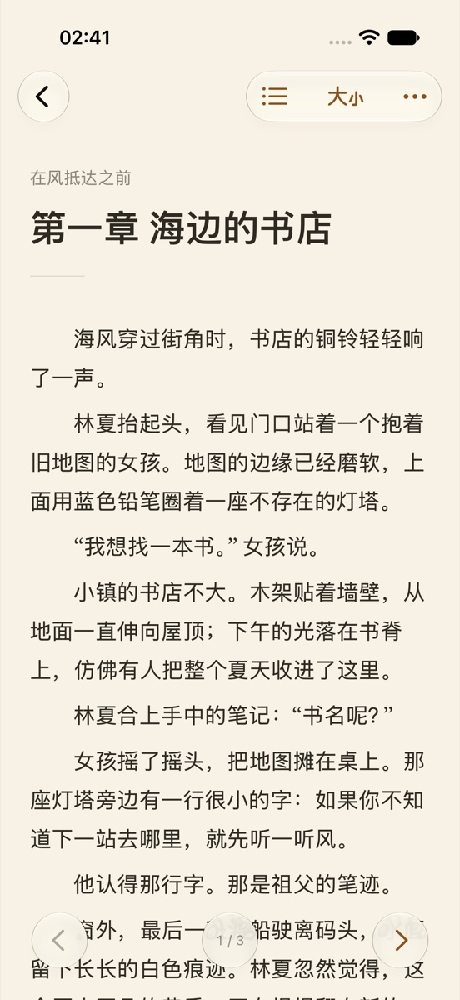 |

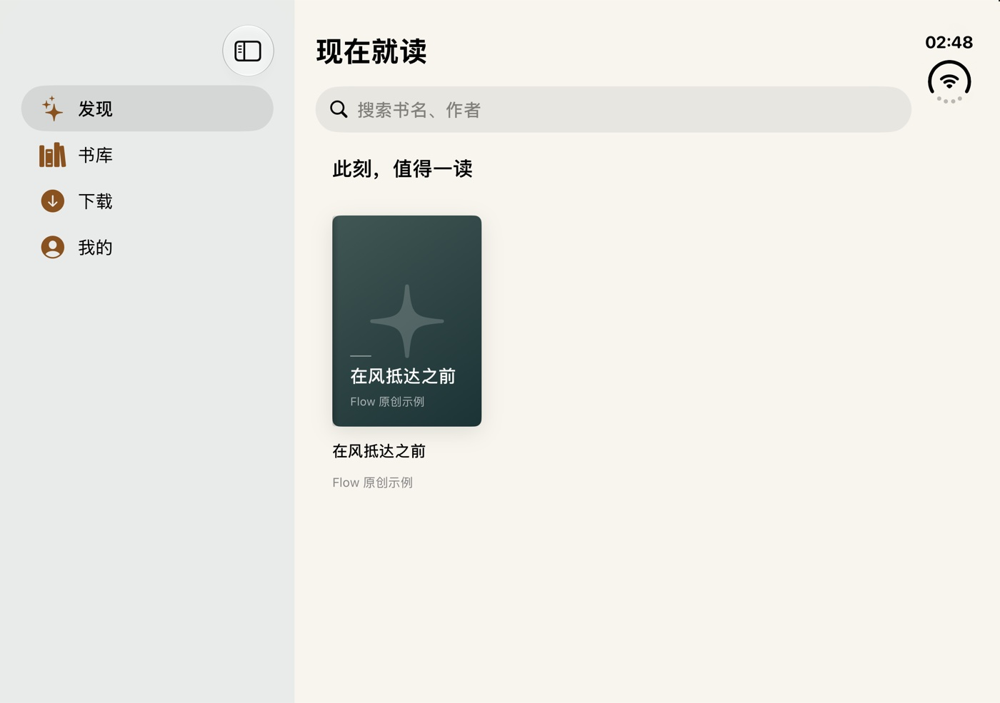

